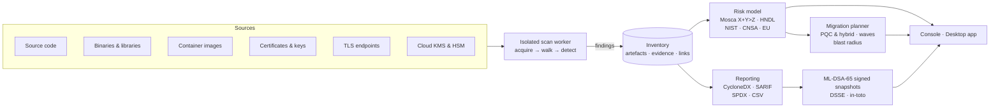

<p align="center">
  
</p>

<h1 align="center">FALCON</h1>

<p align="center">
  <b>Find every key. Measure the quantum risk. Migrate in time.</b><br>
  <sub>Enterprise Cryptographic Discovery &amp; Analysis Tool · Team <b>THETA172</b></sub>
</p>

<p align="center">
  <a href="https://github.com/shriomverma100/FALCON/actions/workflows/ci.yml"></a>
  
  <a href="LICENSE"></a>
  
  <br>
  
  
  
  
  
  
</p>

<p align="center">
  <a href="#-run-it-in-one-command"><b>Run it</b></a> ·
  <a href="#-see-it-working"><b>Watch the tour</b></a> ·
  <a href="#-what-falcon-does"><b>What it does</b></a> ·
  <a href="#-how-falcon-answers-problem-statement-26164"><b>PS 26164</b></a> ·
  <a href="#-documentation"><b>Docs</b></a>
</p>

---

## The problem, in one paragraph

Every organisation runs on RSA, Diffie-Hellman and elliptic-curve cryptography:
in TLS, in SSH, in VPNs, in certificates, in signed firmware, in hardware
security modules. A quantum computer running Shor's algorithm breaks all of it.
That day has not arrived, but **the damage starts now**: an adversary recording
your traffic today can decrypt it the moment it does. NIST disallows
quantum-vulnerable public-key cryptography after 2035 and deprecates it after
2030. Yet almost nobody can answer the first question a migration requires —
*where is our cryptography?* It is scattered across source code, third-party
libraries, compiled binaries, container images, configuration files and cloud
key stores.

**FALCON answers that question, then tells you what to do about it, and proves
you did it.**

---

## ⚡ Run it in one command

Needs **Python 3.12+** and **Node.js 20.19+** (or 22.12+). The first run
installs everything into the project folder — a few minutes, once.

```powershell
# Windows
git clone https://github.com/shriomverma100/FALCON.git
cd FALCON
powershell -ExecutionPolicy Bypass -File scripts\start.ps1
```

```sh
# Linux / macOS
git clone https://github.com/shriomverma100/FALCON.git
cd FALCON
sh scripts/start.sh
```

Your browser opens at <http://127.0.0.1:8600>. **A fresh install is not an
empty one.** FALCON creates a demonstration agency with ten systems and an
admin account, then scans the bundled sample estates with the real engine.
About twenty seconds after start-up, every screen is full of real findings.

<table>
<tr><td><b>Email</b></td><td><code>admin@falcon.local</code></td></tr>
<tr><td><b>Password</b></td><td><code>Quantum-Safe-2026!</code></td></tr>
</table>

The same sign-in is printed in your terminal. Change it under *Settings →
Password & devices*. To start empty with the setup assistant instead, add
`-NoDemo` (Windows) or `--no-demo` (Linux/macOS).

> **Already have a `data/` folder?** FALCON keeps it and does not create the
> demonstration account, so sign in with the account you made — the terminal
> names it at start-up. To get the demonstration instead, stop FALCON, delete
> the `data/` folder and start again.

<details>
<summary><b>Other ways to run it</b> — Docker, the Windows app, CI pipelines</summary>

<br>

**Docker** (needs nothing but Docker):

```sh
docker compose up -d        # http://localhost:8600, same demo and sign-in
```

**Windows desktop app.** Download `FALCON_1.0.0_x64-setup.exe` from
[Releases](https://github.com/shriomverma100/FALCON/releases). A per-user
install, no administrator rights; you create your own account on first launch.
Build it from source with `scripts\build-desktop.ps1` (needs Rust).

**CI pipelines.** The same engine runs offline, with no server:

```sh
falcon scan ./service --format sarif --output falcon.sarif --fail-on high
falcon scan . --format cyclonedx -o cbom.cdx.json --sign-key keys/attestation-mldsa65.pem
falcon verify cbom.cdx.json.dsse.json --key keys/falcon-attestation.pub.pem
```

Configuration, PostgreSQL, TLS, backups and ready-made GitHub Actions and
GitLab CI snippets are in [docs/OPERATIONS.md](docs/OPERATIONS.md).

</details>

---

## 🎬 See it working

<p align="center">
  <a href="docs/media/falcon-tour.mp4">
    <picture>
      <source srcset="docs/media/falcon-tour.webp" type="image/webp">
      
    </picture>
  </a>
</p>

<p align="center">
  <a href="docs/media/falcon-tour.mp4"><b>▶︎ Watch the full 100-second tour</b></a>
  &nbsp;·&nbsp;
  <a href="docs/USER-GUIDE.md">Screen-by-screen guide</a>
</p>

---

## 🔍 What FALCON does

Four steps, each with its own screens.

### 1 · Discover — every piece of cryptography, wherever it hides


<table>
<tr><td width="50%" valign="top">

**Where it looks**

- Folders, archives (zip, tar, jar)
- Git repositories
- Container images — saved tarballs, OCI layouts, registry pulls
- Live TLS endpoints
- Cloud KMS and HSM definitions

</td><td width="50%" valign="top">

**What it reads**

- Source code: a Python syntax-tree analyser plus **259 rules** across 11 language packs
- Dependency manifests, lockfiles, OS packages
- ELF, PE and Mach-O binaries; Java bytecode
- Certificates, keys and keystores
- TLS, SSH and IPsec configuration

</td></tr>
</table>

**A real post-quantum TLS probe.** FALCON builds its own TLS 1.3 ClientHello
offering X25519MLKEM768 with a genuine ML-KEM-768 key share, so it can tell you
which endpoints *already* negotiate post-quantum key exchange.

Every finding maps to one catalogue of **85 algorithms** and **76 libraries**,
is assessed twice (classical strength and against a quantum attacker), and is
de-duplicated by a stable fingerprint so it keeps its identity across scans.

### 2 · Assess — quantum risk, per artefact, with the reasoning shown

<table>
<tr>
<td width="50%"></td>
<td width="50%"></td>
</tr>
<tr>
<td valign="top"><b>Quantum Risk.</b> Score = impact × likelihood, where likelihood is the strongest of: attackable classically today, P(quantum computer arrives within X + Y), and policy deadline pressure. Every score lists its drivers.</td>
<td valign="top"><b>Time Machine.</b> Press play and watch the estate move from secure → at risk → exposed → broken, year by year to 2045, under your chosen threat model.</td>
</tr>
<tr>
<td width="50%"></td>
<td width="50%"></td>
</tr>
<tr>
<td valign="top"><b>Classification.</b> Type × lifetime and likelihood × impact matrices, plus the Mosca plane: every artefact at its data lifetime (X) against its migration effort (Y), with the horizon Z as the line.</td>
<td valign="top"><b>Compliance.</b> NIST IR 8547, NIST SP 800-131A, CNSA 2.0 and the EU PQC roadmap, evaluated per artefact, today and at every future deadline.</td>
</tr>
</table>

> **Harvest now, decrypt later** is scored explicitly. Quantum-vulnerable key
> establishment on a reachable system, protecting data that outlives the
> horizon, is *never* rated below high — because that traffic is already
> compromised, whatever the calendar says.

The complete mathematics, with every weight, is in
[docs/METHODOLOGY.md](docs/METHODOLOGY.md).

### 3 · Plan — what to replace it with, sized and scheduled

<table>
<tr>
<td width="50%"></td>
<td width="50%"></td>
</tr>
<tr>
<td valign="top"><b>Recommendations.</b> A primary replacement (ML-KEM, ML-DSA, SLH-DSA, AES-256-GCM, SHA-384…), a hybrid for the transition (X25519MLKEM768, SecP384r1MLKEM1024, X-Wing, composite ML-DSA), the extra bytes on the wire, and the latency <i>measured on your hardware</i>.</td>
<td valign="top"><b>Migration plan.</b> Five waves — fix now, stop the harvest, long lead, before 2030, complete — scheduled per system, with a completion date and the probability a quantum computer exists by then.</td>
</tr>
<tr>
<td width="50%"></td>
<td width="50%"></td>
</tr>
<tr>
<td valign="top"><b>Blast radius.</b> Which systems share each algorithm, library, certificate and key — so shared cryptography gets migrated once, not five times.</td>
<td valign="top"><b>Benchmark lab.</b> ML-KEM, ML-DSA, hybrids and the classical algorithms they replace, timed on your own machine. The recommendations quote these numbers, not a vendor's.</td>
</tr>
</table>

### 4 · Prove — evidence a third party can verify

<table>
<tr>
<td width="50%"></td>
<td width="50%"></td>
</tr>
<tr>
<td valign="top"><b>Reports.</b> CycloneDX 1.6 CBOM (JSON and XML), SARIF 2.1.0, SPDX 2.3, CSV and JSON — each validated against its official schema. Snapshots are signed with <b>ML-DSA-65</b> (FIPS 204) in a DSSE envelope, with drift tracked between them.</td>
<td valign="top"><b>Executive brief.</b> The whole position on one document for a board or a ministry: risk, systems most at risk, compliance, the roadmap, and what to act on first. Prints to A4.</td>
</tr>
</table>

**Anyone can verify a FALCON snapshot with stock OpenSSL 3.5 — without
FALCON.** The recipe is in [docs/REPORTING.md](docs/REPORTING.md) and is tested
in a clean container on every release.

---

## 🎯 How FALCON answers problem statement 26164

| The problem statement asks for | FALCON delivers | Where to look |
|---|---|---|
| Catalogue algorithms, keys, certificates, protocols, libraries, hardware and cloud services | Seven artefact classes, de-duplicated by fingerprint, with evidence (file, line, detector, confidence) and links between them | Inventory, artefact pages |
| Scan source code, binaries, libraries and containers | Folders, archives, Git, container images, live endpoints; 7 detector families and 259 rules across 11 packs, in isolated workers | Systems → *Add source*, Scans |
| Quantum risk assessment | Impact × likelihood (classical, quantum, policy), every driver explained; harvest-now-decrypt-later scored separately | Quantum Risk, artefact risk card |
| Classify by type, lifetime and criticality using Mosca's inequality | Mosca X, Y and Z per artefact *and* per system; matrices; the Mosca plane; the Time Machine | Quantum Risk, Time Machine, Threat Horizon |
| Recommend PQC or hybrid replacements | Primary, hybrid and alternatives with FIPS sizes and on-host latency; waves, roadmap, blast radius, what-if | Artefact pages, Migration Plan, Blast Radius, Benchmark Lab |
| CBOM and standard report formats | CycloneDX 1.6 (JSON/XML), SARIF 2.1.0, SPDX 2.3, CSV, JSON; ML-DSA-signed snapshots; drift; executive brief | Reports, Executive Brief, `falcon scan` |
| An interactive GUI | A web console and a native Windows app; light, dark and phone layouts; a chart for every view and a table twin for every chart | Everywhere |

📄 **The full submission** — problem, solution, technical approach, feasibility,
impact, requirement-by-requirement evidence and references — is in
**[docs/SIH-SUBMISSION.md](docs/SIH-SUBMISSION.md)**.

---

## 🛡️ Built for real deployment

<table>
<tr><td width="33%" valign="top">

**Secure by design**

- Argon2id passwords, lockout, rate limits
- Six roles, explicit permissions
- SHA-256 hash-chained audit ledger
- Strict Content Security Policy
- Secrets masked before they leave the scan worker

</td><td width="33%" valign="top">

**Air-gap first**

- No outbound calls, ever
- Fonts, knowledge bases and rule packs bundled
- Scans isolated in separate processes
- Runs on-premises, in a container, or on one laptop

</td><td width="33%" valign="top">

**Proven**

- 326 server tests, Windows and Linux
- API tests build their database from the real migrations
- Exports validated against official schemas
- Signatures cross-checked with OpenSSL

</td></tr>
</table>

### A console people actually enjoy

Apple-style glass in light and dark, seven accent colours, and *Reduce
transparency* for those who want it. Every page's code is prefetched when the
console is idle, so navigation paints in about **40 ms**. A small falcon flies
across the screen while anything loads. Quiet interface sounds, rebindable
keyboard shortcuts (press `?`), and a `Ctrl/⌘ K` command palette.

<p align="center">
  
  
</p>
<p align="center">
  
  
</p>

---

## 🏗️ Architecture



| Layer | Built with |
|---|---|
| **Server** | Python 3.12+, FastAPI, SQLAlchemy 2, Alembic · SQLite or PostgreSQL |
| **Cryptography** | pyca/cryptography on OpenSSL 3.5 — ML-KEM, ML-DSA and the classical algorithms |
| **Console** | React 19, TypeScript, Vite, Tailwind 4, Radix, Motion · d3 for chart maths |
| **Desktop** | Tauri 2 (Rust), engine bundled with PyInstaller |

Full detail in [docs/ARCHITECTURE.md](docs/ARCHITECTURE.md).

---

## 📚 Documentation

| Document | What it covers |
|---|---|
| **[SIH submission](docs/SIH-SUBMISSION.md)** | Problem, solution, technical approach, feasibility, impact, requirement evidence, references |
| **[User guide](docs/USER-GUIDE.md)** | Screen by screen, with a five-minute evaluation script |
| [Risk methodology](docs/METHODOLOGY.md) | Threat horizon, Mosca per artefact, scoring, HNDL, compliance and waves — every weight |
| [Reporting](docs/REPORTING.md) | CBOM mapping, SARIF rules, signed snapshots, OpenSSL verification, drift |
| [Architecture](docs/ARCHITECTURE.md) | Components, pipeline, data model, repository layout |
| [API](docs/API.md) | 85 REST endpoints, authentication, examples; full OpenAPI description |
| [Operations](docs/OPERATIONS.md) | Install, configure, Docker, backup, security posture, CLI and CI |
| [Testing](docs/TESTING.md) | How FALCON is verified, and how to run the checks yourself |
| [Changelog](CHANGELOG.md) · [Roadmap](docs/ROADMAP.md) | What shipped, and what each phase delivered |

---

## 🗂️ Repository layout

```
server/      FastAPI service · discovery engine · risk model · migration planner · reporting · CLI
console/     the web console (React, TypeScript)
desktop/     the Windows app (Tauri 2, Rust) and the bundled engine build
fixtures/    synthetic sample estates, a container image and PKI material
docs/        documentation and media
scripts/     setup, start, development and desktop build scripts
```

## 🧑‍💻 Development

```sh
scripts/dev.ps1                                   # API with auto-reload + console with hot reload
cd server  && .venv/Scripts/python -m pytest      # 326 tests (.venv/bin/python on Linux/macOS)
cd console && npx tsc -b && npx vitest run && npm run build
```

Contributions are welcome — see [CONTRIBUTING.md](CONTRIBUTING.md) and our
[Code of Conduct](CODE_OF_CONDUCT.md). For vulnerabilities, please read
[SECURITY.md](SECURITY.md) first.

---

## 👥 Team

Built by **Team THETA172** for Smart India Hackathon, problem statement
**26164** — *Enterprise Cryptographic Discovery & Analysis Tool*, set by the
**National Technical Research Organisation**.

## 📄 Licence

[MIT](LICENSE) © 2026 Team THETA172.

<p align="center">
  <sub>Harvest now, decrypt later is not a future problem. It started the day someone pressed record.</sub>
</p>
