<p align="center">
  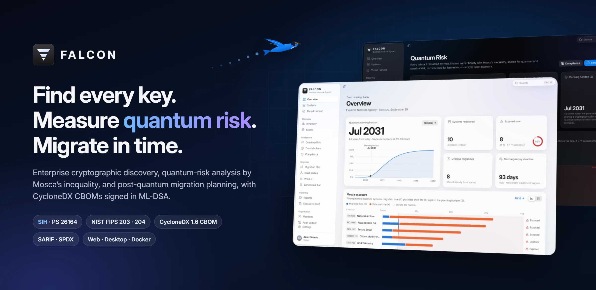
</p>

<p align="center">
  <a href="https://github.com/shriomverma100/FALCON/actions/workflows/ci.yml"></a>
  
  
  
  
  
  
</p>

<p align="center">
  <b>Enterprise Cryptographic Discovery &amp; Analysis Tool (ECDAT)</b><br>
  Smart India Hackathon · problem statement <b>26164</b> · National Technical Research Organisation
</p>

<p align="center">
  <a href="#run-it-in-one-command">Run it</a> ·
  <a href="#see-it-in-action">Tour</a> ·
  <a href="#what-falcon-does">Features</a> ·
  <a href="#how-falcon-meets-problem-statement-26164">PS 26164 mapping</a> ·
  <a href="#documentation">Documentation</a>
</p>

---

**FALCON finds every piece of cryptography an organisation depends on, measures
how exposed each one is to a quantum computer, and plans and proves the move to
post-quantum cryptography.** It scans source code, binaries, libraries, container
images, certificates, keys, protocol configuration, live TLS endpoints and cloud
key management. It scores each finding with Mosca's inequality and the NIST, NSA
and EU deadlines, and recommends the ML-KEM, ML-DSA or hybrid replacement,
measured on your own hardware. It then produces the evidence: a CycloneDX 1.6
cryptography bill of materials (CBOM), SARIF for code scanning, SPDX, and
snapshots signed with post-quantum ML-DSA that anyone can verify with OpenSSL.

It runs fully on-premises and air-gapped, as a web platform, a Windows desktop
app, a Docker container, or a command line inside CI pipelines.

## Run it in one command

Needs **Python 3.12+** and **Node.js 20.19+** (or 22.12+). The first run installs
everything into the project folder, which takes a few minutes, once.

```powershell
# Windows
git clone https://github.com/shriomverma100/FALCON.git
cd FALCON
powershell -ExecutionPolicy Bypass -File scripts\start.ps1
```

```sh
# Linux / macOS
git clone https://github.com/shriomverma100/FALCON.git
cd FALCON
sh scripts/start.sh
```

The browser opens at <http://127.0.0.1:8600>. A fresh install starts as a
working demonstration. FALCON creates the organisation *Example National
Agency*, ten systems and an admin account, then scans the bundled sample
estates with the real engine. About twenty seconds after start-up, every screen
is populated.

| Sign in | |
|---|---|
| **Email** | `admin@falcon.local` |
| **Password** | `Quantum-Safe-2026!` |

The same sign-in is printed in the terminal. Change the password under
*Settings → Password & devices*. To start empty with the setup assistant
instead, add `-NoDemo` (Windows) or `--no-demo` (Linux/macOS).

> **Already have a `data/` folder?** FALCON keeps it and does not create the
> demonstration account, so sign in with the account you made. The terminal
> names it at start-up. To get the demonstration instead, stop FALCON, delete
> the `data/` folder and start again.

<details>
<summary><b>Other ways to run FALCON</b>: Docker, the Windows desktop app, the CI command line</summary>

**Docker**: needs only Docker.

```sh
docker compose up -d        # http://localhost:8600, same demo and sign-in
```

**Windows desktop app.** Download `FALCON_1.0.0_x64-setup.exe` from
[Releases](https://github.com/shriomverma100/FALCON/releases). It is a per-user
install with no administrator rights; you create your own account on first
launch. To build it from source, run `scripts\build-desktop.ps1` (needs Rust).

**CI pipelines.** The same engine runs offline as a command line:

```sh
falcon scan ./service --format sarif --output falcon.sarif --fail-on high
falcon scan . --format cyclonedx -o cbom.cdx.json --sign-key keys/attestation-mldsa65.pem
falcon verify cbom.cdx.json.dsse.json --key keys/falcon-attestation.pub.pem
```

See [docs/OPERATIONS.md](docs/OPERATIONS.md) for configuration, PostgreSQL, TLS,
backups and GitHub Actions and GitLab CI examples.
</details>

## See it in action

<p align="center">
  <a href="docs/media/falcon-tour.mp4">
    <picture>
      <source srcset="docs/media/falcon-tour.webp" type="image/webp">
      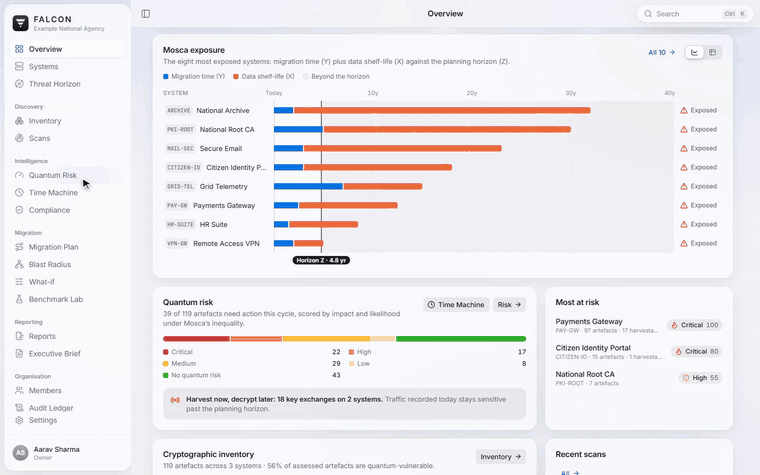
    </picture>
  </a>
  <br>
  <a href="docs/media/falcon-tour.mp4"><b>▶ Watch the full 100-second tour (MP4)</b></a>
</p>

## What FALCON does

FALCON works in four steps, each shown on its own screens.

### 1 · Discover: every algorithm, key, certificate, protocol, library, HSM and cloud key

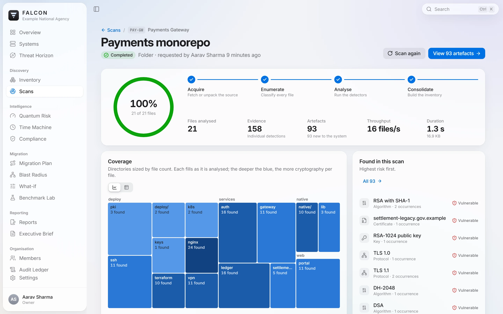

- **Sources:** folders, archives, Git repositories, container images (saved or
  pulled from a registry) and live TLS endpoints. Each scan runs in an isolated
  worker process with live progress over Server-Sent Events.
- **Detectors:**
  - a Python syntax-tree analyser, plus 259 rules for C/C++, C#, Go,
    Java/Kotlin, JavaScript/TypeScript, PHP, Python, Ruby, Rust and Swift;
  - manifests, lockfiles and OS package databases;
  - ELF, PE and Mach-O binaries, and Java bytecode;
  - certificates, keys and keystores;
  - TLS, SSH and IPsec configuration;
  - infrastructure-as-code KMS keys and HSMs.
- **Post-quantum TLS probe:** a real TLS 1.3 handshake offering
  X25519MLKEM768 with a genuine ML-KEM-768 key share. It shows whether each
  endpoint already negotiates post-quantum key exchange.
- **One inventory:** every finding maps to one catalogue of 85 algorithms and
  76 libraries. Each is assessed twice, for classical strength and against a
  quantum attacker, and de-duplicated by fingerprint across scans.

### 2 · Assess: quantum risk by Mosca's inequality, per artefact

| | |
|---|---|
| 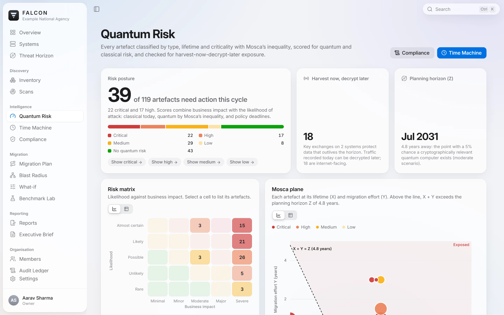 | 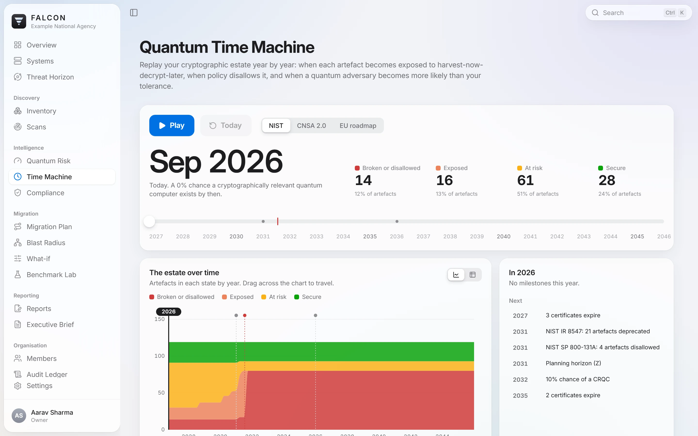 |
| **Quantum Risk.** Score = impact × likelihood, where likelihood is the strongest of classical attack, P(CRQC within X + Y) and policy deadlines. Every score is explained. | **Time Machine.** Press play and watch the estate move from secure to at risk, exposed and broken, year by year to 2045. |
| 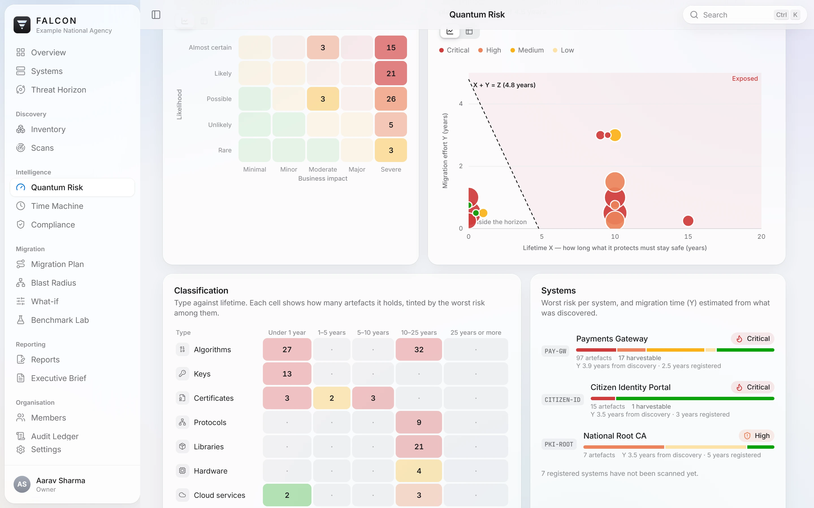 | 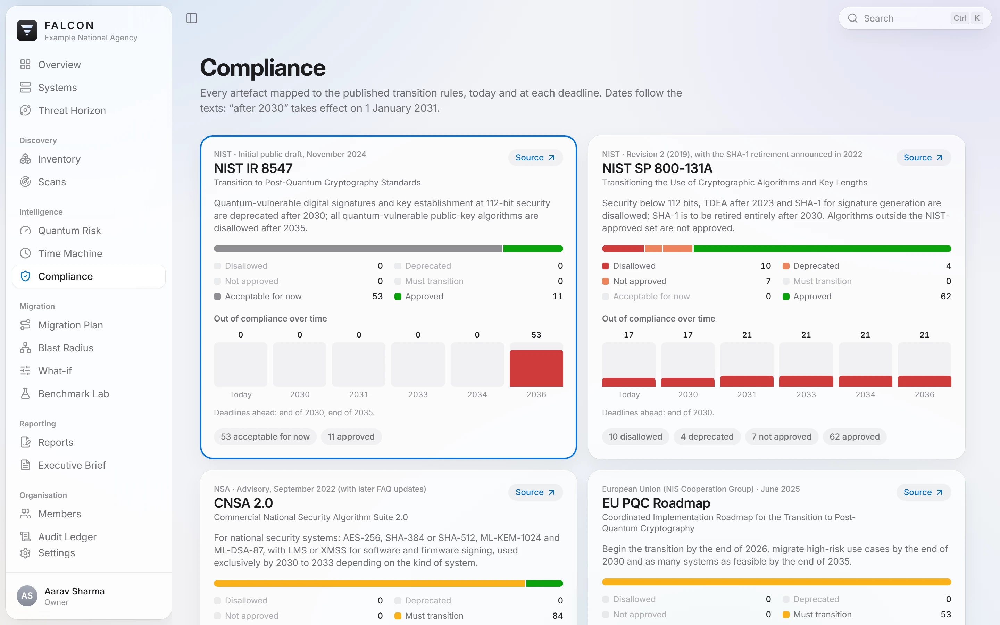 |
| **Classification.** Type × lifetime and likelihood × impact matrices, and the Mosca plane (X against Y against the planning horizon Z). | **Compliance.** NIST IR 8547, NIST SP 800-131A, CNSA 2.0 and the EU PQC roadmap per artefact, with their dates and rules. |

Harvest-now-decrypt-later is scored explicitly. Quantum-vulnerable key
establishment on a reachable system whose data outlives the horizon is never
rated below high. The mathematics is in
[docs/METHODOLOGY.md](docs/METHODOLOGY.md).

### 3 · Plan: post-quantum or hybrid replacements, sized and scheduled

| | |
|---|---|
| 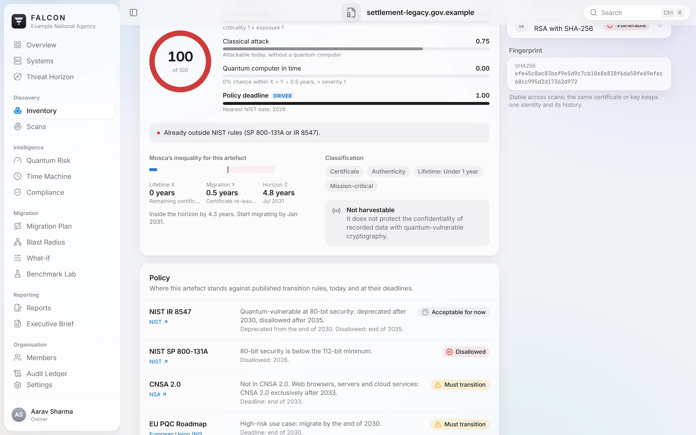 | 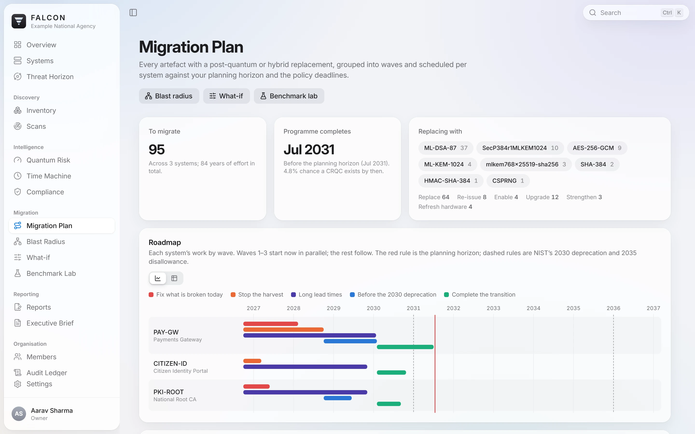 |
| **Recommendations.** For each artefact: a primary replacement (ML-KEM, ML-DSA, SLH-DSA, AES-256-GCM, SHA-384, …), a hybrid for the transition (X25519MLKEM768, SecP384r1MLKEM1024, X-Wing, composite ML-DSA), the extra bytes on the wire, and the latency measured on this host. | **Migration plan.** Five waves (fix now, stop the harvest, long lead, before 2030, complete) on a per-system roadmap. It shows the completion date and the chance a quantum computer exists by then. |
| 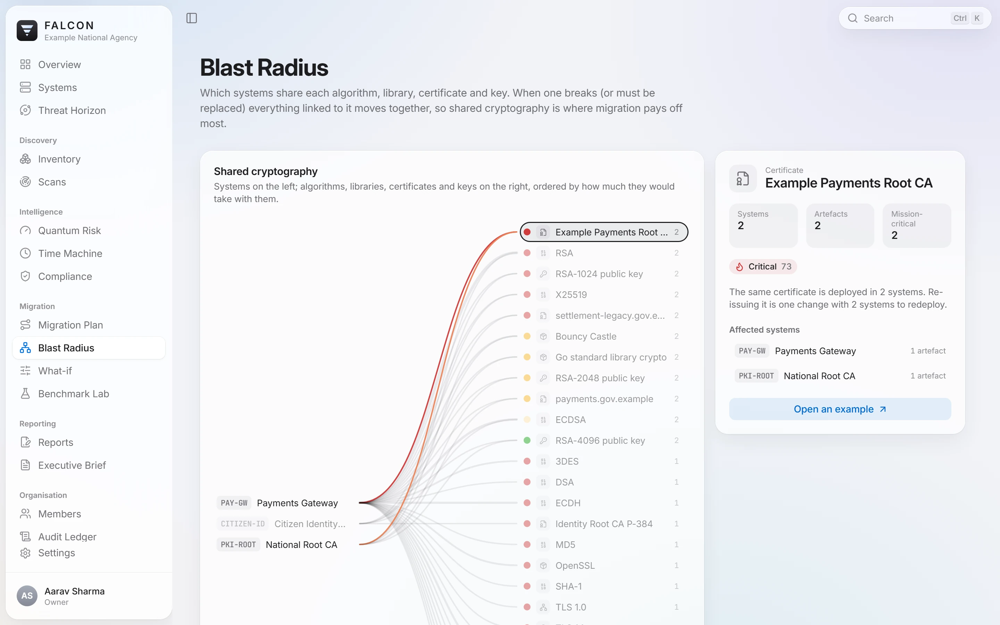 | 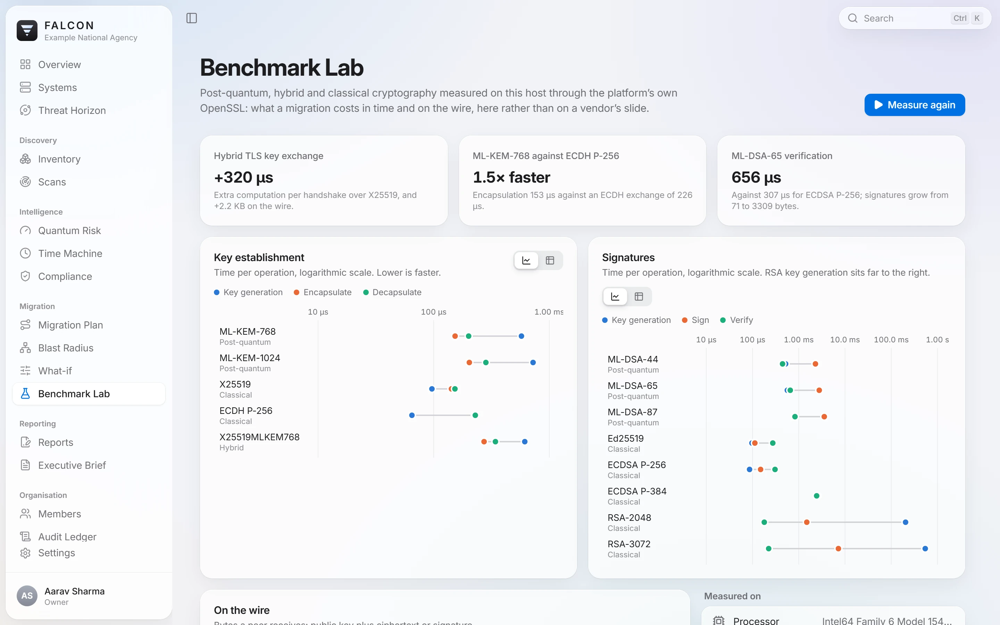 |
| **Blast radius.** Which systems share each algorithm, library, certificate and key, so shared cryptography is migrated once. | **Benchmark lab.** ML-KEM, ML-DSA, hybrid and classical algorithms timed on your own hardware; the recommendations use these numbers. |

### 4 · Prove: standard reports and post-quantum-signed evidence

| | |
|---|---|
| 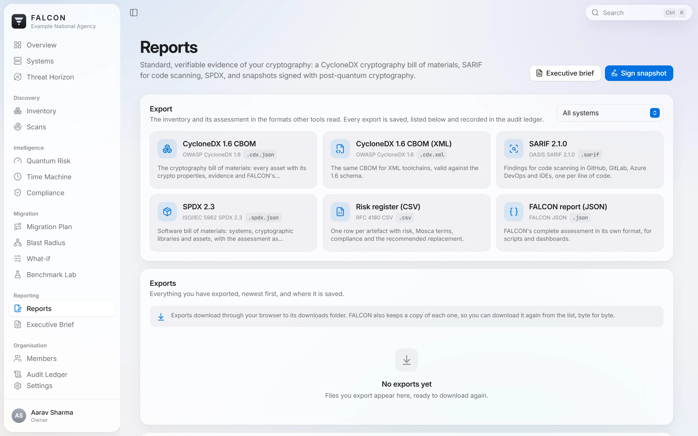 | 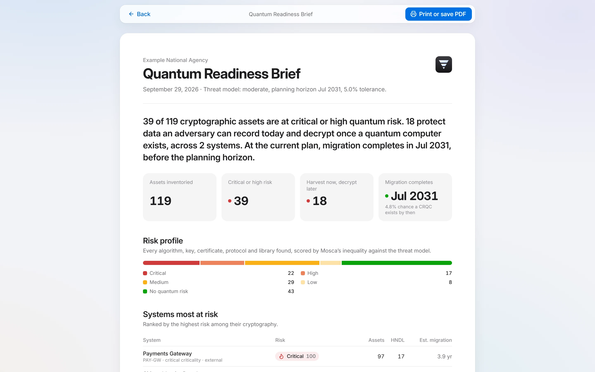 |
| **Reports.** CycloneDX 1.6 CBOM (JSON and XML), SARIF 2.1.0, SPDX 2.3, CSV and JSON, each validated against its official schema. Snapshots are signed with **ML-DSA-65** (FIPS 204) in a DSSE envelope, and drift is tracked between them. | **Executive brief.** The position in one document for leadership: risk, the systems most at risk, compliance, the roadmap and what to act on first. Prints to A4. |

Anyone can verify a FALCON snapshot with stock OpenSSL 3.5, without FALCON. See
[docs/REPORTING.md](docs/REPORTING.md).

## How FALCON meets problem statement 26164

| The problem statement asks for | FALCON delivers | Where to see it |
|---|---|---|
| A catalogue of algorithms, keys, certificates, protocols, libraries, hardware and cloud services | Seven artefact classes, de-duplicated by fingerprint, with evidence (file, line, detector, confidence) and links between them | Inventory, artefact pages |
| Scanning of source code, binaries, libraries and containers | Folders, archives, Git, container images (saved or registry), live TLS endpoints; 7 detector families plus 259 rules in 11 packs | Systems → *Add source*, Scans |
| Quantum risk assessment | Impact × likelihood (classical, quantum, policy), with every driver explained; harvest-now-decrypt-later | Quantum Risk, artefact risk card |
| Classification by type, lifetime and criticality using Mosca's inequality | Mosca X, Y and Z per artefact and system; type × lifetime and likelihood × impact matrices; the Mosca plane; the Time Machine | Quantum Risk, Time Machine, Threat Horizon |
| PQC or hybrid recommendations | Primary, hybrid and alternatives with FIPS sizes and on-host latency; waves, roadmap, blast radius, what-if | Artefact pages, Migration Plan, Blast Radius, What-if, Benchmark Lab |
| CBOM and standard report formats | CycloneDX 1.6 CBOM (JSON and XML), SARIF 2.1.0, SPDX 2.3, CSV, JSON; ML-DSA-signed snapshots; drift; executive brief | Reports, Executive Brief, `falcon scan` |
| An interactive GUI | A web console, a Windows desktop app, and light, dark and phone layouts, with a chart for every view and a table twin for every chart | Everywhere |

The full requirement-by-requirement evidence, the technical approach,
feasibility and impact are in the
[SIH submission document](docs/SIH-SUBMISSION.md).

## Built for real use

- **Secure by design:**
  - Argon2id passwords, lockout and rate limits; session cookies protected
    against cross-site requests.
  - Role-based access with explicit permissions.
  - A SHA-256 hash-chained audit ledger records every change, export and
    signature.
  - A strict Content Security Policy.
  - Secrets found in code are masked before they leave the scan worker.
- **Air-gapped:** no outbound calls; fonts, knowledge bases and rule packs are
  bundled.
- **Tested:**
  - 325 server tests, and every API test runs on a fresh database built
    by the real migrations.
  - Exports are validated against the official CycloneDX, SARIF and SPDX
    schemas, and signatures are cross-checked with OpenSSL.
  - Tests run on Windows and Linux. See [docs/TESTING.md](docs/TESTING.md).
- **A console people enjoy using:**
  - Apple-style glass, light and dark, seven accent colours, *Reduce
    transparency*.
  - Every page's code is prefetched when idle, so navigation paints in about
    40 ms. A small falcon flies across the screen while anything loads.
  - Quiet interface sounds, rebindable keyboard shortcuts (`?` lists them),
    a `Ctrl/⌘ K` command palette.

<p align="center">
  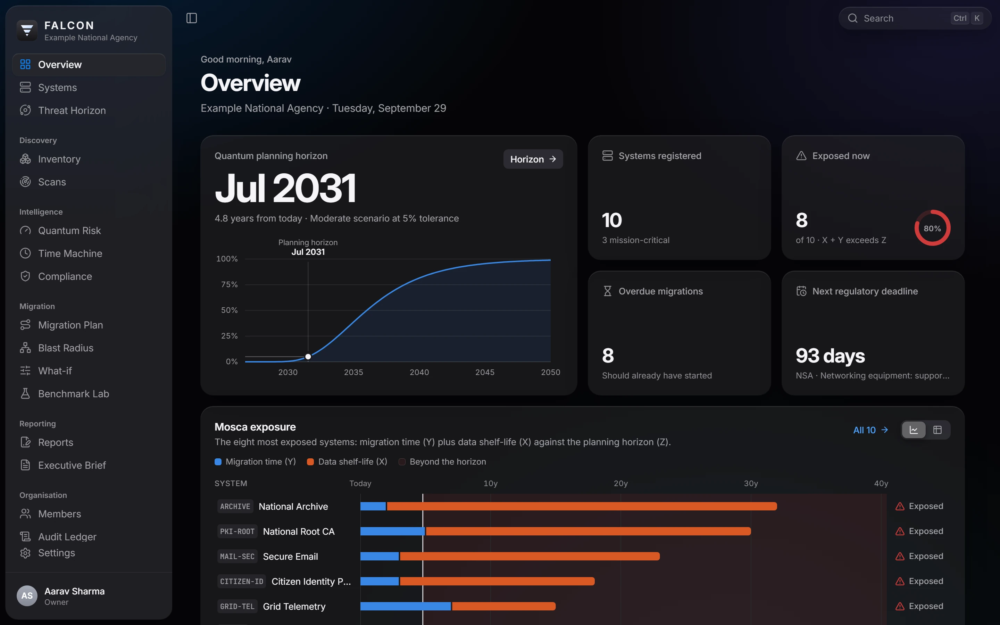
  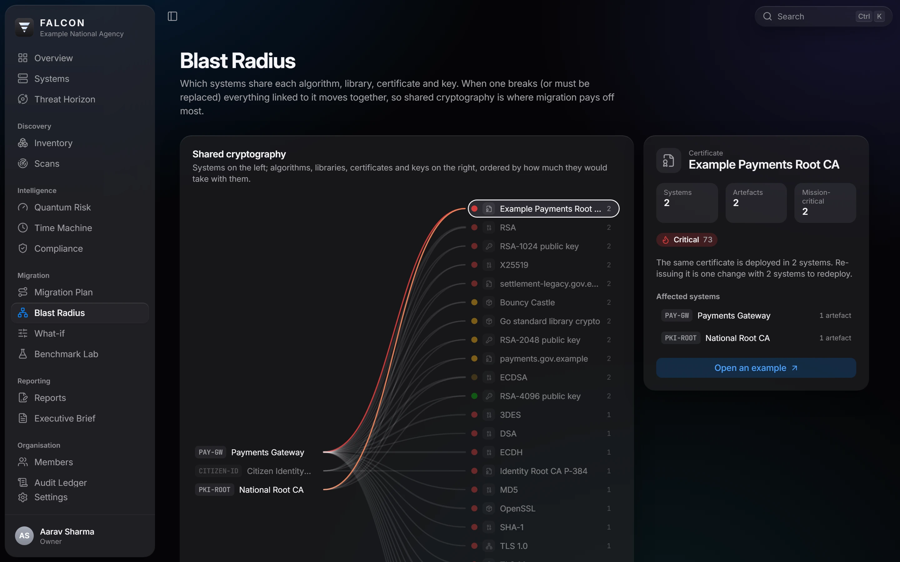
</p>
<p align="center">
  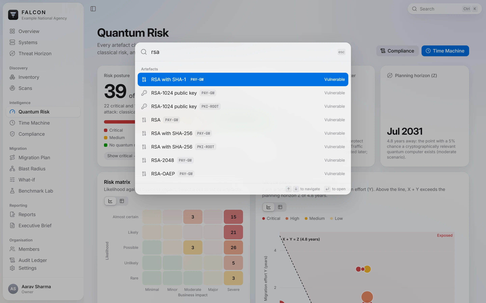
  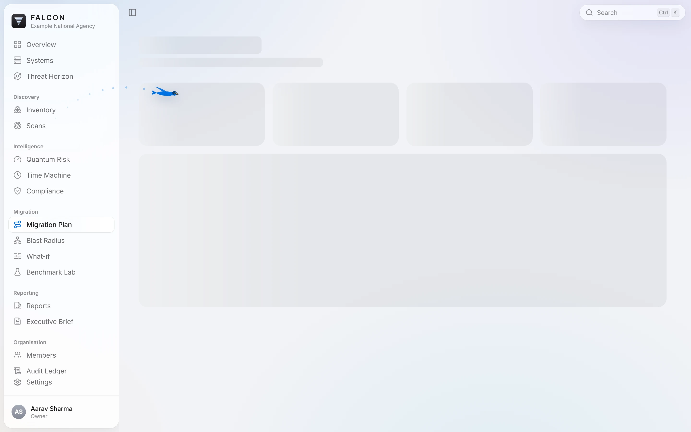
</p>

## Architecture

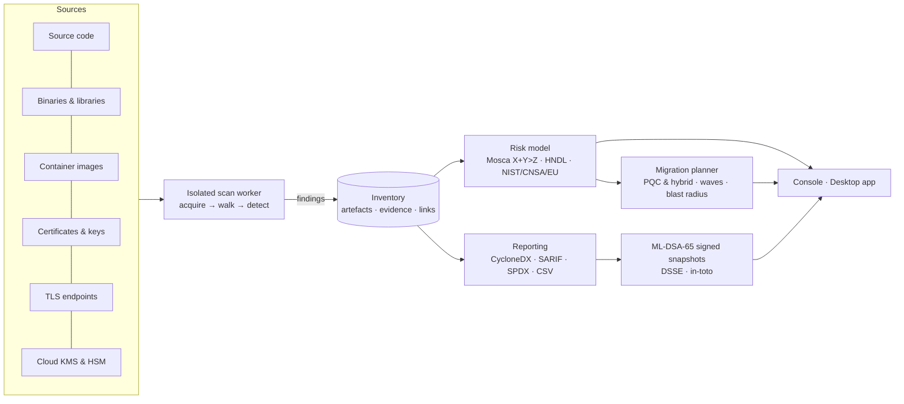

**Stack:**

- **Server:** Python 3.12+, FastAPI, SQLAlchemy 2 and Alembic, with SQLite or
  PostgreSQL.
- **Cryptography:** pyca/cryptography, for ML-KEM, ML-DSA and the classical
  algorithms.
- **Console:** React 19, TypeScript, Vite, Tailwind 4, Radix, Motion, and d3
  for the chart math.
- **Desktop:** Tauri 2 (Rust).

The details are in [docs/ARCHITECTURE.md](docs/ARCHITECTURE.md).

## Documentation

| Document | For |
|---|---|
| [SIH submission](docs/SIH-SUBMISSION.md) | The problem, the proposed solution, technical approach, feasibility, impact, and requirement-by-requirement evidence |
| [User guide](docs/USER-GUIDE.md) | A screen-by-screen walkthrough, and a five-minute demo script |
| [Risk methodology](docs/METHODOLOGY.md) | The threat horizon, Mosca per artefact, scoring, HNDL, compliance and waves, with every weight |
| [Reporting](docs/REPORTING.md) | CBOM mapping, SARIF rules, signed snapshots, verification with OpenSSL, drift, export locations |
| [Architecture](docs/ARCHITECTURE.md) | Components, pipeline, data model and repository layout |
| [API](docs/API.md) | REST API overview and authentication; the full OpenAPI description |
| [Operations](docs/OPERATIONS.md) | Installation, configuration, Docker, backup, security posture, CLI and CI |
| [Testing](docs/TESTING.md) | How FALCON is verified, and how to run the checks |
| [Roadmap](docs/ROADMAP.md) | What was delivered in each of the five phases |

## Repository layout

```
server/      FastAPI service, discovery engine, risk model, migration planner, reporting, CLI (Python)
console/     the web console (React, TypeScript)
desktop/     the Windows desktop app (Tauri 2, Rust) and the bundled engine build
fixtures/    sample estates, a container image and PKI material for the demo and tests
docs/        documentation and media
scripts/     setup, start, development and desktop build scripts
```

## Development

```sh
scripts/dev.ps1                                   # API with auto-reload + console with hot reload (Windows)
cd server  && .venv/Scripts/python -m pytest      # server tests (use .venv/bin/python on Linux/macOS)
cd console && npx tsc -b && npx vitest run && npm run build
```

## Licence

[MIT](LICENSE) © 2026 Shriom Verma.
