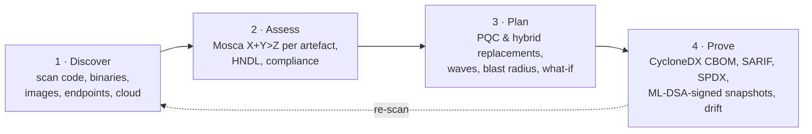
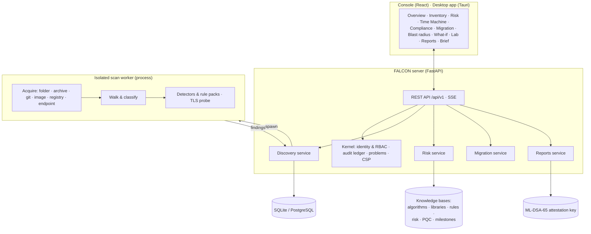

# FALCON: SIH submission

| | |
|---|---|
| **Team** | THETA172 |
| **Project** | FALCON |
| **Problem statement** | 26164: Enterprise Cryptographic Discovery & Analysis Tool (ECDAT) |
| **Organisation** | National Technical Research Organisation (NTRO) |
| **Category** | Software |
| **Solution** | FALCON: post-quantum cryptographic discovery and migration intelligence |
| **Repository** | <https://github.com/shriomverma100/FALCON> |
| **Try it** | `scripts\start.ps1` (Windows) or `sh scripts/start.sh`, then sign in as `admin@falcon.local` / `Quantum-Safe-2026!` |

---

## 1. The problem

Every organisation runs on public-key cryptography: TLS, SSH and VPN key
exchange, code and document signatures, certificates, hardware security modules
and cloud keys. A cryptographically relevant quantum computer (CRQC) running
Shor's algorithm will break RSA, Diffie-Hellman and elliptic-curve cryptography
outright. Grover's algorithm halves the strength of symmetric keys and hashes.

Three facts make this urgent now, not when a CRQC appears:

1. **Harvest now, decrypt later.** Traffic recorded today can be decrypted once
   a CRQC exists. Data that must stay secret for 10–30 years is already exposed.
2. **Deadlines are set.**
   - NIST IR 8547 deprecates quantum-vulnerable public-key algorithms after
     2030 and disallows them after 2035.
   - CNSA 2.0 requires post-quantum algorithms in national security systems
     from 2030 to 2033.
   - The EU roadmap asks for high-risk systems to migrate by 2030.
3. **Nobody knows where their cryptography is.** It is buried in source code,
   third-party libraries, compiled binaries, container images, configuration
   files, certificates and cloud key stores. Migration cannot be planned
   without an inventory.

Mosca's inequality captures the risk. If **X** (how long data must stay
protected) plus **Y** (how long migration takes) exceeds **Z** (the time until a
CRQC exists), the data is already at risk.

## 2. What the problem statement requires, and how FALCON meets it

Every requirement below is implemented, tested and visible in the running
platform.

| # | Requirement | How FALCON meets it | See it | Evidence |
|---|---|---|---|---|
| R1 | Catalogue algorithms, keys, certificates, protocols, libraries, hardware and cloud services | Seven artefact classes in one inventory. Each is de-duplicated by a stable fingerprint across scans, carries its evidence (file, line, masked snippet, detector, confidence), and is linked to related artefacts (a certificate to its key and signature algorithm) | Inventory, artefact pages | `test_discovery_engine.py`, `test_discovery_api.py`, `test_names.py` |
| R2 | Scan source code, binaries, libraries and containers | Sources: folders, archives, Git repositories, container images (`docker save`, OCI layout, or pulled from a registry) and live TLS endpoints. Seven detector families plus 259 rules in 11 language packs. Scans run in isolated worker processes with live progress | Systems → *Add source*, Scans, live scan view | `test_discovery_engine.py`, `test_endpoints.py`, `test_long_paths.py` |
| R3 | Quantum risk assessment | Score = impact × likelihood. Likelihood is the strongest of classical attack today, P(CRQC within X + Y), and policy deadline pressure. Every score shows its drivers | Quantum Risk, artefact risk card | `test_risk_model.py`, `test_risk_api.py` |
| R4 | Classify by type, lifetime and criticality using Mosca's inequality | Mosca X, Y and Z per artefact and per system. X comes from the artefact's role (confidentiality → data shelf-life; certificate → remaining validity); Y from where it was found; Z from the organisation's threat model. Type × lifetime and likelihood × impact matrices, the Mosca plane, and the Quantum Time Machine | Quantum Risk, Time Machine, Threat Horizon | `test_risk_model.py`, `test_horizon.py` |
| R5 | Recommend PQC or hybrid replacements | A primary replacement (ML-KEM, ML-DSA, SLH-DSA, AES-256-GCM, SHA-384, …), a hybrid for the transition (X25519MLKEM768, SecP384r1MLKEM1024, X-Wing, composite ML-DSA) and alternatives. Each comes with FIPS key and signature sizes, latency measured on the host, effort and steps. Category 5 is chosen for secret, restricted or critical systems | Artefact pages, Migration Plan, Benchmark Lab | `test_migration.py` |
| R6 | Produce a CBOM and standard reports | CycloneDX 1.6 CBOM (JSON and XML), SARIF 2.1.0, SPDX 2.3, CSV, JSON, each validated against its official schema. ML-DSA-65-signed snapshots (DSSE and in-toto). Drift between snapshots. A printable executive brief | Reports, Executive Brief, `falcon scan` | `test_reports.py`, `test_exports.py` |
| R7 | An interactive GUI | A web console and a Windows desktop app, with light, dark and phone layouts. Every chart has a table view; there is a command palette, keyboard shortcuts and live scan progress | Every screen | [User guide](USER-GUIDE.md) |

### Beyond the requirements

- **Migration planning:**
  - five waves on a per-system roadmap, with the chance a CRQC arrives before
    completion;
  - a **blast-radius** graph of shared cryptography;
  - a **what-if** simulator;
  - an on-host **benchmark lab** that times ML-KEM, ML-DSA and hybrids against
    the classical algorithms.
- **Verification:**
  - re-scans are diffed to show what was retired and what was introduced;
  - drift is computed between signed snapshots.
- **Compliance:** NIST IR 8547, NIST SP 800-131A, CNSA 2.0 and the EU PQC
  roadmap, per artefact, with dates.
- **CI/CD:**
  - the same engine runs offline as `falcon scan`;
  - `--fail-on` gates a build, SARIF annotates pull requests, and `--sign-key`
    signs a CBOM for every build.
- **Governance:**
  - six roles with explicit permissions;
  - a tamper-evident, hash-chained audit ledger;
  - every export, signature and key rotation is recorded.

## 3. Proposed solution

FALCON is a single platform that takes an organisation from *"we don't know
where our cryptography is"* to *"we have a signed, verifiable migration record"*.

### What makes it different

1. **Mosca per artefact, not per organisation.** Each certificate, key and
   algorithm gets its own X and Y from where it was found and what it
   protects. The risk register is specific to the artefact, and explains
   itself.
2. **Time as a first-class dimension.** The Time Machine replays the estate
   year by year to 2045, showing when each artefact becomes at risk, exposed
   and broken under the chosen threat model.
3. **A genuine post-quantum TLS probe.** FALCON builds its own TLS 1.3
   ClientHello with a real ML-KEM-768 key share (X25519MLKEM768), so it can
   tell whether an endpoint already negotiates post-quantum key exchange.
4. **Evidence signed with post-quantum cryptography.** Snapshots of the CBOM
   are signed with ML-DSA-65 (FIPS 204). Anyone can verify them with stock
   OpenSSL 3.5; the recipe is tested in a clean container.
5. **Recommendations measured on your hardware.** The benchmark lab times
   ML-KEM, ML-DSA and hybrids through the platform's own OpenSSL. The overhead
   and latency shown for each recommendation are real numbers from the
   machine running FALCON.
6. **Built for sensitive networks:**
   - on-premises and air-gapped, with no outbound calls;
   - secrets masked at the source;
   - scans isolated in separate processes;
   - an audit ledger that detects tampering.
7. **One engine, four ways to run it:**
   - a web platform;
   - a Windows desktop app;
   - a Docker container;
   - an offline command line for CI pipelines.

## 4. Technical approach

### Technology

| Layer | Choice | Why |
|---|---|---|
| Server | Python 3.12+, FastAPI, SQLAlchemy 2, Alembic | Typed, testable, a mature cryptography ecosystem |
| Cryptography | pyca/cryptography (OpenSSL 3.5+): ML-KEM, ML-DSA, X25519, ECDSA, RSA | Standards-grade primitives for the probe, benchmarks and attestations |
| Storage | SQLite (WAL) by default; PostgreSQL | Zero-setup for evaluation, scalable for production |
| Console | React 19, TypeScript, Vite, Tailwind 4, Radix, Motion; d3 for scales and shapes | Fast, accessible, animated data visualisation |
| Desktop | Tauri 2 (Rust) with the engine bundled by PyInstaller | A native Windows installer about 27 MB in size |
| Packaging | Docker (Debian trixie, OpenSSL 3.5), docker compose | One-command server deployment |

### Architecture

### How each part works

- **Discovery**
  - Acquisition is defensive:
    - archive-bomb and path-traversal limits;
    - symbolic links are ignored;
    - Git hooks and submodules are disabled;
    - container image layers are applied with whiteouts.
  - Every finding is normalised by a name grammar (JCA, OpenSSL, JOSE, TLS,
    SSH, IPsec and X.509 OIDs) into one algorithm catalogue with its
    parameters. It is assessed twice: for classical strength (NIST SP 800-57
    and SP 800-131A) and for quantum strength (Shor and Grover).
- **Risk.** The full model is in [METHODOLOGY.md](METHODOLOGY.md).
  - CRQC arrival is log-normal. The planning horizon Z is the quantile at the
    organisation's tolerance.
  - Per artefact: `score = 100 × impact × max(classical, quantum severity × P(T ≤ X + Y), policy pressure)`.
  - Harvest-now-decrypt-later applies to quantum-vulnerable confidentiality on
    a reachable system with positive Mosca exposure.
- **Migration**
  - A rules engine over `knowledge/pqc.json` gives FIPS 203/204/205 sizes and
    library-specific steps.
  - Waves are scheduled per system against the planning horizon and the
    policy deadlines.
- **Reporting**
  - The CycloneDX 1.6 CBOM uses the crypto-asset model: algorithm properties
    with the NIST quantum security level, certificate and key references,
    protocol cipher suites, and evidence occurrences.
  - SARIF 2.1.0 has eight rules.
  - Snapshots are in-toto Statement v1 in a DSSE envelope, signed with
    ML-DSA-65.
- **Security**
  - Argon2id passwords, lockout and rate limits.
  - `HttpOnly`, `SameSite=Strict` cookies with a check against cross-site
    requests.
  - Explicit permissions per role.
  - A SHA-256 hash-chained audit ledger.
  - A strict Content Security Policy and RFC 9457 error responses.
  - Secrets found in code are masked before they leave the worker.

## 5. Implementation methodology

FALCON was delivered in five phases. Each ended in a working, tested platform.

| Phase | Delivered |
|---|---|
| 1. Foundation | Identity and access, organisation, systems register, quantum threat horizon, audit ledger, design system, visualisation engine |
| 2. Discovery engine and desktop | Detectors, scan sources, live scan view, the inventory, the Windows desktop app |
| 3. Quantum risk intelligence | Risk model, Mosca per artefact, HNDL, classification, compliance, Time Machine |
| 4. PQC migration planning | Recommendations, benchmark lab, waves and roadmap, blast radius, what-if, before/after verification |
| 5. CBOM, reporting and hardening | CycloneDX, SARIF, SPDX, CSV; ML-DSA-signed snapshots; drift; executive brief; CI command line; containers; documentation |

The details are in [ROADMAP.md](ROADMAP.md).

## 6. Feasibility and viability

**It runs today, everywhere an evaluator might try it:**

- a one-command start on Windows, Linux and macOS;
- Docker;
- a Windows installer.

A fresh install seeds a realistic demonstration organisation with ten systems
and real scans.

**Performance:**

- The engine analyses about 210 files per second per core, ruling out files
  that cannot match with literal and whole-file prefilters.
- Scans run in parallel worker processes, two by default and configurable.
- Risk is computed on read, so a change to the threat model re-prices the
  whole estate instantly.

**Quality:**

- 326 server tests, run on Windows and on Linux (Debian trixie).
- API tests run on fresh databases built by the real migrations.
- Exports are validated against the official CycloneDX 1.6, SARIF 2.1.0 and
  SPDX 2.3 schemas.
- ML-DSA signatures are cross-checked with OpenSSL.

See [TESTING.md](TESTING.md).

**Challenges and how FALCON handles them:**

| Challenge | Mitigation |
|---|---|
| False positives in pattern matching | Syntax-tree analysis for Python, gated and prefiltered rules, a confidence score on every occurrence, and evidence with the exact line |
| Compiled or third-party code | Binary analysis: linkage, version banners, Go build information, cryptographic constants. Manifest and lockfile analysis. Library knowledge base with post-quantum readiness and end-of-life data |
| Cryptography only visible on the wire | The live TLS probe records version, cipher, certificate chain, legacy protocol support and post-quantum key-exchange support |
| Standards and deadlines change | Versioned JSON knowledge bases (algorithms, libraries, rules, risk weights, PQC parameters, milestones) that can be reviewed and updated without code changes |
| Sensitive environments | Air-gapped, with no outbound calls; secrets masked; permissions per role; tamper-evident audit |
| Scale | PostgreSQL, parallel scan workers, scan limits, incremental re-scans that keep artefact identity |
| Deep container images on Windows | Extended-length paths for scan workspaces, covered by a regression test |

## 7. Impact and benefits

- **Visibility:**
  - one inventory of every cryptographic asset across code, infrastructure and
    cloud;
  - the prerequisite for any migration and for compliance reporting.
- **Prioritisation:**
  - risk that explains itself, in years and probabilities rather than
    opinions;
  - harvest-now-decrypt-later separates what must move now from what can
    wait.
- **Planning:**
  - realistic effort, a roadmap per system and the chance of finishing before
    a CRQC;
  - shared cryptography (the blast radius) is migrated once, not per system.
- **Assurance:**
  - signed, verifiable evidence of the cryptographic estate at any moment, and
    of how it changed;
  - suitable for audits, regulators and supply-chain requirements (a CBOM from
    every build).
- **National interest:**
  - protects long-lived government and citizen data against future
    decryption;
  - aligns migration with the NIST, NSA and EU timelines that shape vendor
    ecosystems.

## 8. Five-minute evaluation script

1. Start FALCON and sign in (see the top of this document). The **Overview**
   shows the planning horizon, the systems exposed by Mosca's inequality and
   the next regulatory deadline.
2. **Systems → Payments Gateway → Add source.** Add a folder, archive, image or
   endpoint and watch the **live scan**. The demo's scans are already there
   under **Scans**.
3. **Inventory:** open a critical artefact, for example the RSA-1024
   certificate. It shows the evidence, the quantum and classical assessment,
   the risk drivers and the **recommended replacement**.
4. **Quantum Risk → Time Machine:** press **Play** and watch the estate age to
   2045.
5. **Compliance:** NIST IR 8547, SP 800-131A, CNSA 2.0 and the EU roadmap.
6. **Migration Plan → Blast Radius → What-if → Benchmark Lab.**
7. **Reports:**
   1. Export the CycloneDX CBOM or SARIF.
   2. Open the **signed snapshot** and see it verify.
   3. Drop the exported `.dsse.json` file on *Verify an attestation*.
8. **Executive Brief:** print or save it as a PDF.

## 9. Research and references

- NIST FIPS 203, *Module-Lattice-Based Key-Encapsulation Mechanism Standard* (ML-KEM), 2024.
- NIST FIPS 204, *Module-Lattice-Based Digital Signature Standard* (ML-DSA), 2024.
- NIST FIPS 205, *Stateless Hash-Based Digital Signature Standard* (SLH-DSA), 2024.
- NIST IR 8547 (initial public draft), *Transition to Post-Quantum Cryptography Standards*, 2024.
- NIST SP 800-131A Rev. 2, *Transitioning the Use of Cryptographic Algorithms and Key Lengths*, 2019.
- NIST SP 800-57 Part 1 Rev. 5, *Recommendation for Key Management*, 2020.
- NSA, *Commercial National Security Algorithm Suite 2.0* (CNSA 2.0), 2022.
- NIS Cooperation Group, *Coordinated Implementation Roadmap for the Transition to Post-Quantum Cryptography*, 2025.
- M. Mosca, "Cybersecurity in an Era with Quantum Computers: Will We Be Ready?", *IEEE Security & Privacy* 16(5), 2018.
- Global Risk Institute, *Quantum Threat Timeline Report* (annual).
- OWASP CycloneDX 1.6 specification: Cryptography Bill of Materials (CBOM).
- OASIS, *Static Analysis Results Interchange Format (SARIF) 2.1.0*.
- SPDX 2.3 specification (ISO/IEC 5962).
- DSSE (Dead Simple Signing Envelope) and in-toto Attestation Framework, Statement v1.
- RFC 8446 (TLS 1.3); IETF draft *Post-quantum hybrid ECDHE-MLKEM key agreement for TLS 1.3* (X25519MLKEM768).
- RFC 8996 (deprecating TLS 1.0 and 1.1); RFC 9142 (SSH key exchange method updates); RFC 9370 (multiple key exchanges in IKEv2).
