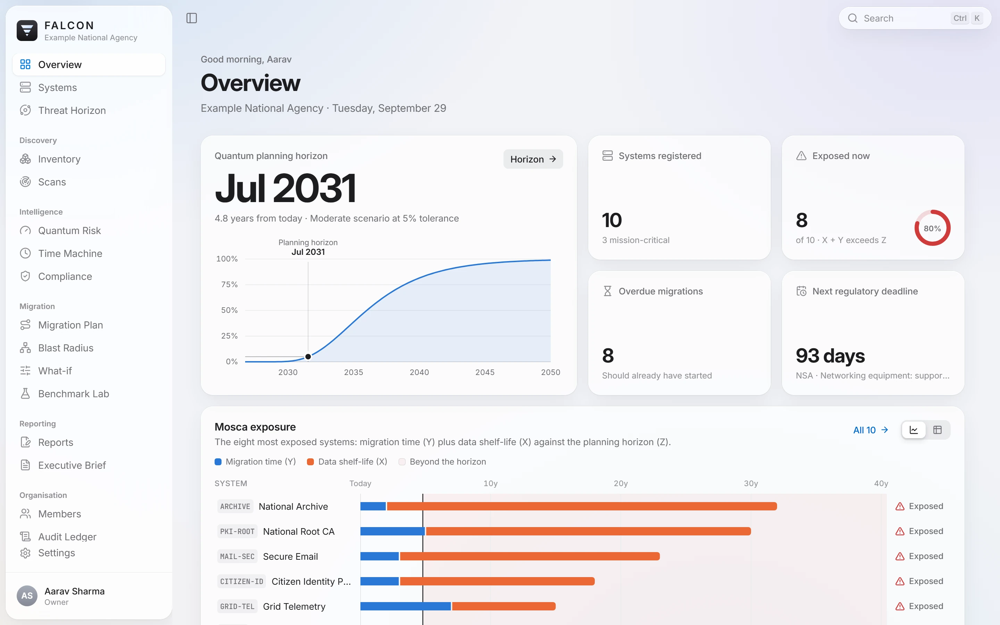
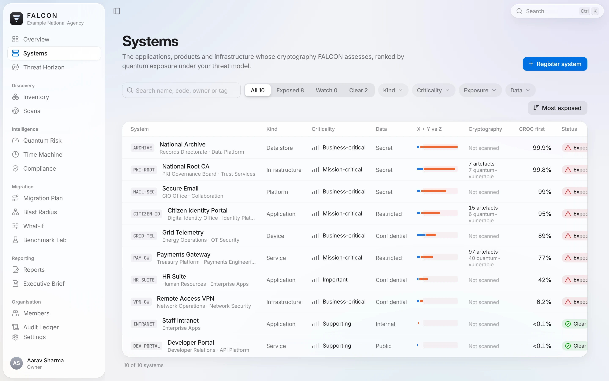
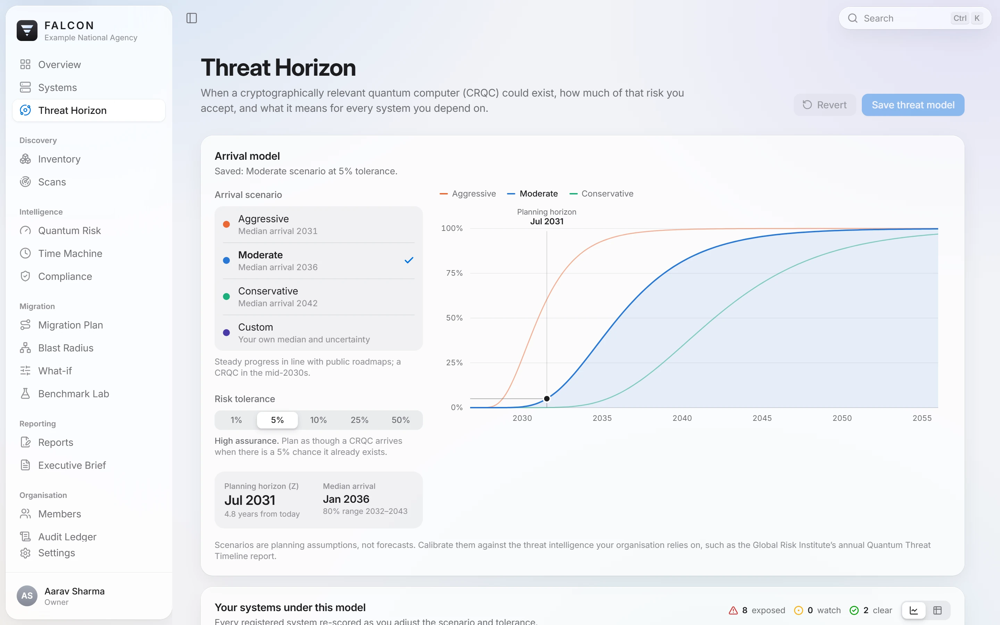
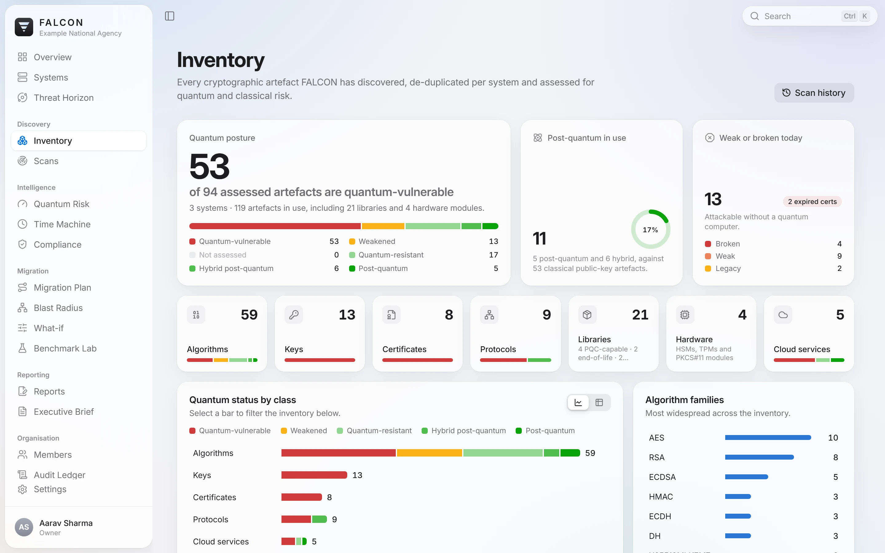
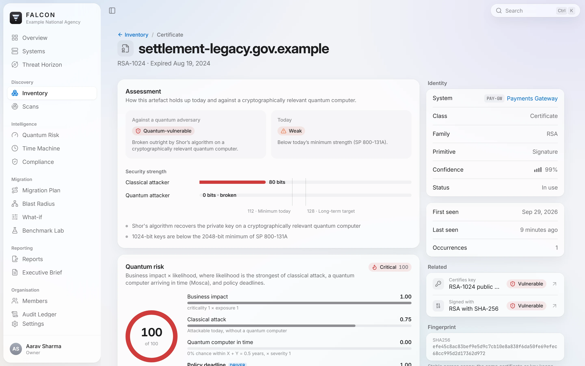
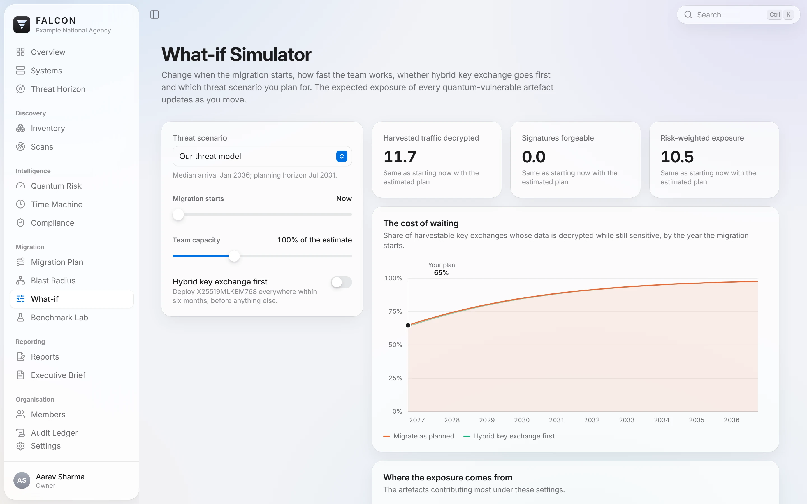
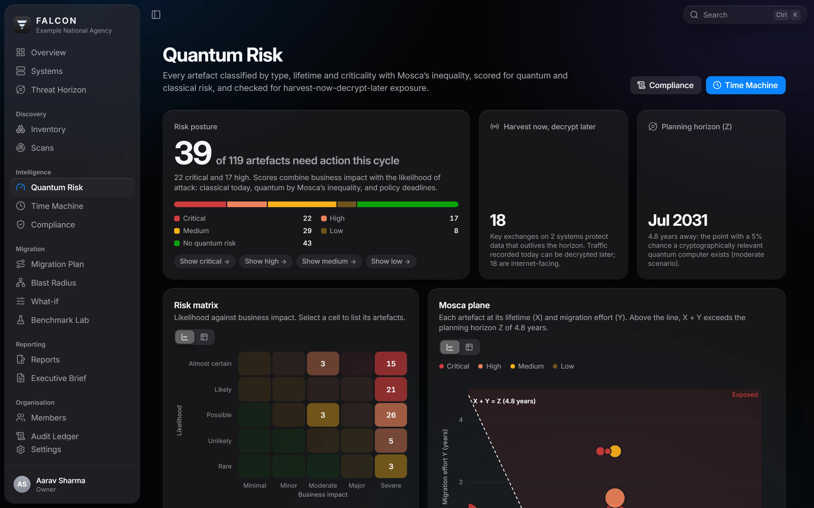
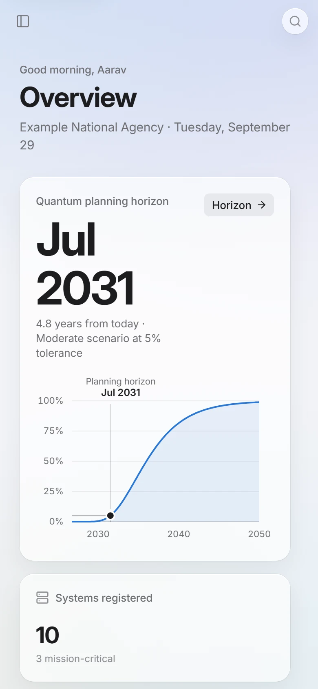

# User guide

A walk through FALCON, screen by screen. Start it as described in the
[README](../README.md#run-it-in-one-command) and sign in as
`admin@falcon.local` / `Quantum-Safe-2026!`. The demonstration organisation has
ten systems and finished scans, so every screen below has data.

- [First look: the Overview](#first-look-the-overview)
- [Systems and the threat horizon](#systems-and-the-threat-horizon)
- [Discovering cryptography](#discovering-cryptography)
- [The inventory](#the-inventory)
- [Quantum risk](#quantum-risk)
- [Time Machine and Compliance](#time-machine-and-compliance)
- [Planning the migration](#planning-the-migration)
- [Reports and evidence](#reports-and-evidence)
- [Working faster](#working-faster)
- [Settings, members and the audit ledger](#settings-members-and-the-audit-ledger)
- [The desktop app](#the-desktop-app)

## First look: the Overview

The Overview answers three questions:

- **When should we plan for a quantum computer?** The *quantum planning
  horizon* (Mosca's **Z**) comes from the organisation's threat model: a
  scenario for when a CRQC arrives and the chance you accept of being late.
- **Which systems are already exposed?** A system is exposed when the time its
  data must stay secret (**X**) plus its migration time (**Y**) exceeds **Z**.
- **What is due next?** The nearest regulatory deadline, the overdue
  migrations, and the risk, discovery and scan summaries below.

## Systems and the threat horizon

**Systems** is the register of applications, services, platforms and devices.
Each carries its business context, which FALCON uses in every risk calculation:

- criticality;
- exposure (internet, partner, internal, isolated);
- data classification;
- data shelf-life (X);
- migration time (Y).

**Threat Horizon** is where the organisation chooses its threat model:

- a scenario (aggressive, moderate, conservative, or custom);
- the risk tolerance.

The curve is the probability that a CRQC exists by each year. The planning
horizon moves as you change the settings, and every risk score in FALCON
follows it.

## Discovering cryptography

Open a system and choose **Add source**:

| Source | What FALCON scans |
|---|---|
| Folder | A directory on the server (or any folder in the desktop app) |
| Archive | zip, tar, tar.gz or jar, by upload or local path |
| Git repository | https or ssh URL, optional branch or tag |
| Container image | A `docker save` or OCI tarball, or a registry reference such as `registry/app:tag` |
| TLS endpoints | `host:port` list; includes the post-quantum key-exchange probe |

A scan runs in an isolated worker process. The live view shows:

- the stages;
- files per second;
- a coverage treemap that fills folder by folder as it is analysed;
- a feed of cryptography as it is found.

When a source is scanned again, **Since the previous scan** shows what was
retired, introduced, or spread to new places.

## The inventory

The **Inventory** lists every artefact found: algorithms, keys, certificates,
protocols, libraries, hardware modules and cloud keys. Filter by kind,
quantum status, classical status, system or text.

An artefact page shows:

- **Assessment:** its strength today and against a quantum attacker, with the
  reasons.
- **Quantum risk:** the score and every term that produced it (business
  impact, classical attack, quantum computer in time, policy deadline).
- **Identity and related artefacts:** a certificate's key and signature
  algorithm.
- **Evidence:** every file and line where it was found, with the detector,
  the rule and its confidence. Secrets are masked.

Further down, the **recommended migration** gives:

- the post-quantum replacement and a hybrid for the transition;
- the size change on the wire and the latency measured on this computer;
- the steps to take.

## Quantum risk

**Quantum Risk** is the risk register:

- **Risk posture:** critical, high, medium, low, or no quantum risk.
- **Harvest now, decrypt later:** key exchanges whose protected data
  outlives the horizon on reachable systems.
- **Risk matrix:** likelihood × business impact. Select a cell to list its
  artefacts.
- **Mosca plane:** every artefact at its lifetime (X) and migration effort
  (Y); above the line, X + Y exceeds Z.
- **Register:** sortable and filterable, with the main driver of each score.

The mathematics is in [METHODOLOGY.md](METHODOLOGY.md).

## Time Machine and Compliance

The **Time Machine** replays the estate year by year. Press **Play**, or drag
the year, to watch artefacts move from secure to *at risk*, *exposed* and
*broken or disallowed*. The *policy lens* shows the same years through a
single framework.

**Compliance** evaluates every artefact against four frameworks, today and at
each deadline:

- NIST IR 8547;
- NIST SP 800-131A;
- NSA CNSA 2.0;
- the EU PQC roadmap.

## Planning the migration

The **Migration Plan** groups everything that needs replacing into five waves:

1. fix what is broken today;
2. stop the harvest;
3. long lead times;
4. before the 2030 deprecation;
5. complete the transition.

It schedules the waves per system on a roadmap against the planning horizon
and NIST's 2030 and 2035 dates. *Programme completes* gives the date, and the
chance a CRQC exists by then.

**Blast Radius** shows which systems share each algorithm, library,
certificate and key. Shared cryptography is where one change moves several
systems at once.

**What-if** replays the plan in the browser under other assumptions:

- the threat scenario;
- how long before migration starts;
- team capacity;
- hybrid key exchange first.

It shows the effect on three outcomes:

- harvested traffic decrypted;
- signatures forgeable;
- risk-weighted exposure.

**Benchmark Lab** measures key generation, encapsulation, signing and
verification on this computer, for:

- ML-KEM-768 and ML-KEM-1024;
- ML-DSA-44, ML-DSA-65 and ML-DSA-87;
- hybrid X25519MLKEM768;
- the classical algorithms they replace.

The recommendations use these numbers.

## Reports and evidence

**Reports**:

- **Export** the inventory and its assessment in six formats. A menu at the
  top right of the card limits the export to one system:
  - CycloneDX 1.6 CBOM, in JSON or XML;
  - SARIF 2.1.0;
  - SPDX 2.3;
  - CSV;
  - JSON.
- **Exports:** everything exported, and where it was saved.
  - In the desktop app, exports go to a folder you choose (default:
    `Downloads\FALCON Exports`), with **Show in Folder**.
  - In a browser, files download and FALCON keeps a copy to download again.
- **Signed snapshots:** the CBOM at a moment, signed with the organisation's
  ML-DSA-65 key. The four verification checks tick in live.
- **Drift:** what changed since a snapshot.
- **Signing key:** its fingerprint, the public key download, and the OpenSSL
  command to verify independently.
- **Verify an attestation:** drop any `.dsse.json` file to check it.
- **In the pipeline:** ready-made GitHub Actions and GitLab CI snippets.

The **Executive Brief** is the position on one document. It prints as A4, or
choose *Print or save PDF*.

## Working faster

- **Search anything:** `Ctrl K` (`⌘ K` on a Mac) finds pages, systems,
  artefacts and actions, and remembers recent pages.
- **Keyboard:**
  - `?` lists every shortcut;
  - `G` then a letter goes to a page (`G R` Quantum Risk, `G E` Reports, `G D`
    downloads);
  - `/` searches the current page.
  - Rebind any shortcut in *Settings → Keyboard*.
- **Downloads:** the toolbar's download button lists recent exports.
- **Loading:** a small falcon flies across the screen while a page or its
  data loads. With *reduce motion* on, it pulses in place.

## Settings, members and the audit ledger

- **Settings:**
  - account and password, and signed-in devices;
  - appearance: light, dark or automatic, seven accent colours, *Reduce
    transparency*;
  - sounds;
  - keyboard shortcuts;
  - exports and downloads;
  - organisation;
  - personal access tokens for the API.
- **Members:** invite people with one of six roles: owner, administrator,
  security lead, analyst, auditor or viewer.
- **Audit Ledger:** every change, export, signature and key rotation, in a
  SHA-256 hash chain. **Verify** re-checks the whole chain and detects any
  alteration, deletion or reordering.

## The desktop app

Install `FALCON_1.0.0_x64-setup.exe` from the repository's Releases. It is a
per-user install with no administrator rights. On first launch the setup
assistant creates your organisation and account. The desktop app:

- runs the same engine on your own machine;
- uses native folder and file pickers;
- saves exports straight to a folder you choose.

